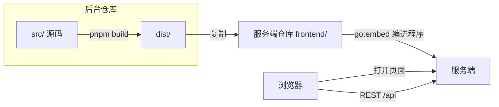

# Fast Note Sync 管理后台：新人导览

> **30 秒版**：这是 Fast Note Sync 的管理后台，是[整套系统](../../../fast-note-sync-service/docs/atlas/README.md)里在浏览器打开的那一端。用户在这里浏览和编辑笔记、管理笔记库和附件、看历史版本和回收站、管理分享；管理员在这里配置备份、Git、存储、用户，创建给 AI 用的令牌，以及一键升级服务端。它是一个 React 单页应用，自己不单独部署：构建产物放进服务端仓库的 `frontend/`，随服务端一起发布。

## 组成

| 部分 | 一句话 | 什么时候读 | 文档 |
|---|---|---|---|
| 三个入口 | 后台主界面、分享页、MCP 的 OAuth 授权页，各是一个独立的 HTML 入口 | 改某个页面的整体结构 | [main.tsx](../../src/main.tsx)、[share.tsx](../../src/share.tsx)、[oauth-authorize.tsx](../../src/oauth-authorize.tsx) |
| 接口层 | 调服务端 REST 接口的封装，一类资源一个文件 | 加或改对服务端的调用 | [src/components/api-handle/](../../src/components/api-handle/) |
| 笔记与附件 | 笔记库、笔记树、Markdown 编辑和预览、附件、历史版本、回收站 | 改编辑器或笔记浏览 | [note/](../../src/components/note/)、[vault/](../../src/components/vault/)、[file/](../../src/components/file/) |
| 系统设置 | 备份、Git、存储、用户管理、版本与升级、在线设备 | 改管理员功能 | [setting/](../../src/components/setting/) |
| MCP 接入 | 创建给 AI 用的令牌、测试连接 | 改 AI 接入页 | [mcp/](../../src/components/mcp/)；服务端一侧见 [AI 接入](../../../fast-note-sync-service/docs/atlas/ai-access.md) |
| 分享 | 分享管理和分享页 | 改分享 | [share/](../../src/components/share/)；服务端一侧见[分享](../../../fast-note-sync-service/docs/atlas/share.md) |
| 布局与多语言 | 页面框架、导航、主题、五种界面语言 | 改整体外观或文案 | [layout/](../../src/components/layout/)、[src/i18n/](../../src/i18n/) |

## 怎么配合

**开发时**，`pnpm dev` 起 Vite 开发服务器，把 `/api` 请求代理到本机 9000 端口上运行的服务端（[vite.config.ts](../../vite.config.ts)）。

**发布时**，`pnpm build` 先做类型检查再构建，产物在 `dist/`，包括三个 HTML 入口和它们的 gzip、Brotli 压缩版。用 `make dist mac`（或 `win`）把 `dist/` 复制到服务端仓库的 `frontend/`：它先清空目标目录，旧的带哈希文件不会残留；目标目录在 `.env` 的 `DIST_PATH_MAC` / `DIST_PATH_WIN` 里配。手动复制时也要先清空 `frontend/`。服务端编译时用 `go:embed` 把它编进程序（服务端的 [router_static.go](../../../fast-note-sync-service/internal/routers/router_static.go)）。之后照常发布服务端的版本，见服务端的[发布与升级](../../../fast-note-sync-service/docs/atlas/release.md)。

**页面切换**不用路由库：当前的笔记库和页面写在 URL 的查询参数里（例如 `/?mcp` 打开 MCP 接入页，[use-url-sync.ts](../../src/hooks/use-url-sync.ts)）。全局状态用 zustand（[app-store.ts](../../src/stores/app-store.ts)）。

## 坑

- **改了源码，线上页面不会变**。→ 线上用的是服务端程序里编进去的 `frontend/`。→ 构建、复制到服务端的 `frontend/`、再重新构建和发布服务端，三步缺一不可。
- **`make dist` 会先清空目标目录**。目标目录来自 `.env` 里的 `DIST_PATH_MAC` 或 `DIST_PATH_WIN`。→ 路径配错，清空的就是别的目录。→ 第一次用之前确认路径指向服务端仓库的 `frontend/`。
- **每次构建，`frontend/` 里几百个带哈希的文件名都会变**。→ 服务端的提交 diff 很大，看不出改了什么。→ 前端产物单独一个提交，和服务端代码的改动分开。
- **后台和服务端不在同一个域名时，MCP 连接测试报网络错误**。→ 服务端要允许后台的 Origin，见[AI 接入](../../../fast-note-sync-service/docs/atlas/ai-access.md)的坑。

## 文档地图

| 文档 | 在哪 | 给谁 | 活的 / 冻结 | 谁维护 |
|---|---|---|---|---|
| 整套系统 | [服务端仓库的 atlas](../../../fast-note-sync-service/docs/atlas/README.md) | 开发者 | 活的 | 我 |
| 后台的使用说明 | 服务端的运行手册 [mcp-access](../../../fast-note-sync-service/docs/runbook/mcp-access.zh-CN.md) 等 | 用户 | 活的 | 我 |

本仓库没有 README 和其他文档。
